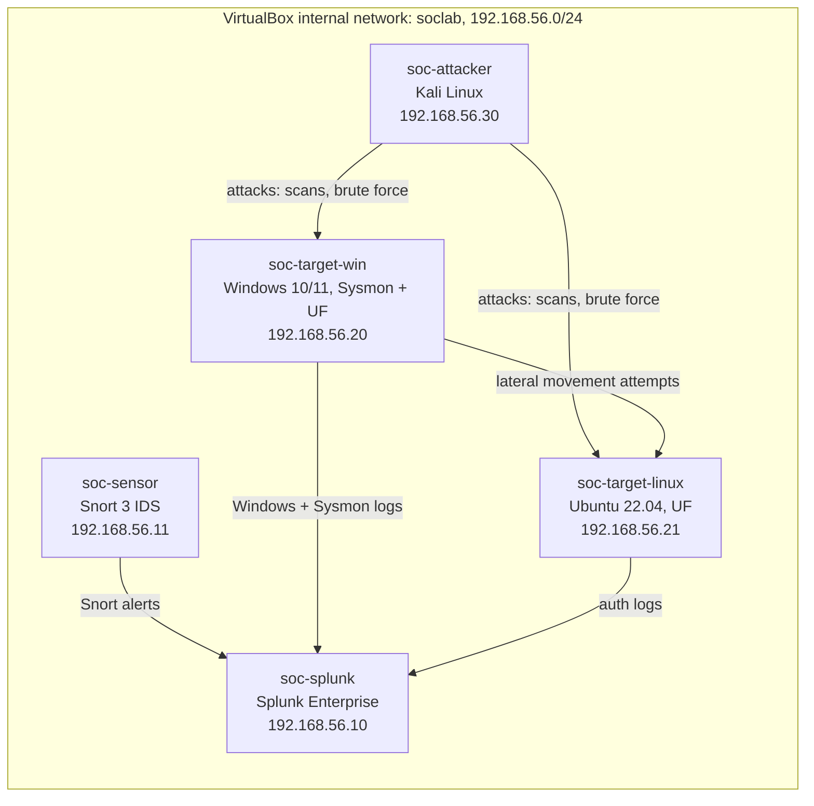

# Home SOC Lab: SIEM and Intrusion Detection

A home Security Operations Center lab built in VirtualBox: Splunk Enterprise
for log ingestion and triage, Snort 3 for intrusion detection, scripted
attack scenarios run from Kali Linux, written triage playbooks, and Python
automation that parses the logs and generates IOC incident reports.

The lab covers three attack classes end to end: port scans, brute-force
attempts, and lateral movement.

## Architecture

All VMs sit on an isolated VirtualBox internal network, `soclab`
(192.168.56.0/24). The only NAT adapter is on the Splunk VM, used for package
installs and disabled otherwise. Nothing in the lab can reach the home
network.



| VM | OS | Role | IP |
|---|---|---|---|
| soc-splunk | Ubuntu Server 22.04 | Splunk Enterprise (free tier), indexer and search head | 192.168.56.10 |
| soc-sensor | Ubuntu Server 22.04 | Snort 3 IDS, promiscuous on the internal network, forwards alerts to Splunk | 192.168.56.11 |
| soc-target-win | Windows 10/11 eval | Target: Sysmon and Splunk Universal Forwarder, Windows Event Logs | 192.168.56.20 |
| soc-target-linux | Ubuntu Desktop 22.04 | Target: auth logs, Splunk Universal Forwarder | 192.168.56.21 |
| soc-attacker | Kali Linux | Attacker: Nmap, Hydra, Metasploit | 192.168.56.30 |

Host floor: 16 GB RAM, 4 or more cores, 120 GB free disk.

## Phase 1 quickstart (no VMs needed)

Phase 1 is the Python automation core. It runs anywhere with Python 3 and
the shipped sample logs (fictional lab data in both Snort and Splunk CSV
format, covering all three attack classes).

Generate an incident report from the sample Snort log:

```bash
python src/ioc_report.py --input src/samples/snort-alerts.log --out reports/incident-001.md
```

The same generator accepts the Splunk CSV export:

```bash
python src/ioc_report.py --input src/samples/splunk-export.csv --out reports/incident-002.md
```

Run the test suite (only dependency beyond the standard library is pytest):

```bash
python -m pytest src/tests/ -v
```

The report includes: summary counts by signature, an IOC table (source IPs,
destination ports, signatures, attempted usernames), a first-seen and
last-seen timeline per attack class, a MITRE ATT&CK mapping, and recommended
actions keyed to each attack class. A real generated example is at
[reports/incident-001.md](reports/incident-001.md).

## Repo map

| Path | Contents |
|---|---|
| `docs/build-guide.md` | Step-by-step VM and tool build (Phase 2) |
| `docs/playbooks/` | Triage playbooks, one per attack class (Phase 4) |
| `docs/screenshots/` | Screenshots from real lab runs (Phase 5) |
| `snort/rules/local.rules` | Custom Snort detection rules (Phase 3) |
| `snort/snort-config-notes.md` | Snort setup and Splunk forwarding notes (Phases 2-3) |
| `splunk/dashboards/` | Exported dashboard XML: SOC Overview, Attack Triage (Phase 4) |
| `splunk/savedsearches.conf` | Saved searches and alerts per attack class (Phase 4) |
| `scenarios/` | Scripted attack scenarios with expected alerts (Phase 3) |
| `src/parse_logs.py` | Parses Snort alert logs and Splunk CSV exports into common records, extracts IOCs |
| `src/ioc_report.py` | CLI that generates the Markdown IOC incident report |
| `src/tests/` | Pytest suite for the parser and the report generator |
| `src/samples/` | Sample Snort log and Splunk CSV export of the same 17 events |
| `reports/` | Generated incident reports (incident-001.md is a real run on the sample log) |

## Skills demonstrated

- Log analysis and IOC extraction: parsing Snort alert_fast output and
  Splunk CSV exports, normalizing them into one record structure.
- Python automation for SOC triage: a tested CLI that turns raw alerts into
  a readable incident report with counts, a timeline, and next actions.
- Detection content design: Snort rule classes and Splunk content planned
  per attack class, mapped to MITRE ATT&CK (T1046, T1595, T1110.001,
  T1021.002, T1021.006).
- Incident response process: NIST-phased triage playbooks planned per
  attack class, with the report's recommended actions drawn from them.

## Status (honest)

- Phase 1, scaffold and automation core: **complete**. Repo structure,
  `parse_logs.py`, `ioc_report.py`, sample logs in both formats, a passing
  pytest suite, and one real generated report.
- Phase 2, lab build (VirtualBox VMs, Splunk, Snort, forwarders): planned,
  not started. The build guide is a placeholder until the build is executed.
- Phase 3, detection rules and attack scenarios: planned. The scenario and
  rules files are placeholders; no scenario has been run yet.
- Phase 4, Splunk dashboards, saved searches, and playbooks: planned. The
  dashboard files are placeholder exports, not working content.
- Phase 5, screenshots from real runs, an end-to-end demo, final README: planned.

Nothing beyond Phase 1 is claimed. Claims ship only when the phase that
proves them is complete.
